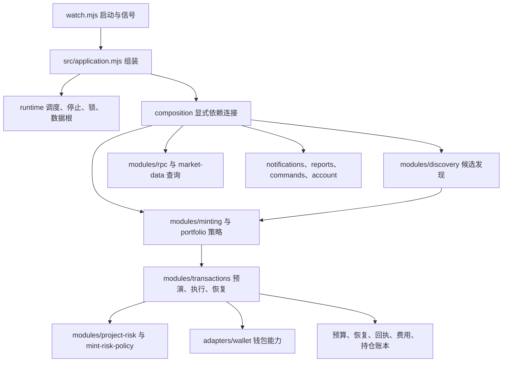

# 模块结构

第一阶段保留 JavaScript / Node.js 和现有 JSON 账本。导入 `watch.mjs` 不执行任何 I/O；直接运行才启动应用。

| 边界 | 责任 |
| --- | --- |
| `src/domain/` | 配置、金额与合约意图校验；可序列化的操作状态；确定未发送的错误类型 |
| `src/adapters/wallet.mjs` | 用参数数组调用 baw，禁止 shell；区分查询、登录和交易能力；所有发送执行停机检查 |
| `src/modules/transactions.mjs` | 唯一资金执行服务：预算、钱包串行、回执、持仓记账、授权清理和恢复 |
| `src/modules/discovery.mjs`、`contracts.mjs` | 区块、事件、合约查询和候选发现 |
| `src/modules/minting.mjs`、`portfolio.mjs` | 原有铸造及卖出策略，调用交易服务，不直接发送 |
| `src/modules/project-risk.mjs` | 合约、开发者及已知黑名单和已观测同款部署拦截；完整历史尚未接入 |
| `src/modules/rpc.mjs`、`market-data.mjs` | 可注入网络传输的 RPC 与行情查询 |
| `src/modules/notifications.mjs`、`reports.mjs`、`commands.mjs`、`account.mjs` | 通知、报表、命令、登录状态；撤销额度交给交易服务验证 |
| `src/runtime/` | 单实例锁、调度、在途任务、停止、数据根绑定 |
| `src/composition.mjs` | 连接显式依赖；兼容扫描、策略、通知之间的函数依赖，不把内部注册表交给模块 |

根目录中的 `project-budget`、`recovery-journal`、`execution-state`、`mint-recovery`、`receipt-fees`、`approval-*`、`swap-recovery` 等安全模块继续复用。保留原路径有助于核对前后行为。

## 交易不变量

- 资金金额在外部意图中是十进制整数字符串，在计算中是 BigInt；不能经过浮点原始数量。行情和展示价格仍使用 Number。
- 先持久化预算/恢复记录，再调用钱包。返回交易哈希不等于完成；必须核对回执和链上资产，再记账。
- 只有本地 `NotSubmittedError` 证明没有调用发送接口，才可释放预留。断网、CLI 报错、缺少哈希都按未知结果保留。
- 同一钱包的交易工作流串行；清理失败阻止下一次授权。停机期间不新发撤销交易，清理记录保留到重启。
- 当前没有完整的 Permit2 内部授权清理验证；交易服务在创建任务或发单前拒绝所有新自动兑换。历史未完成兑换的恢复和清理仍可运行。
- 合约执行前会再次只读核对币安钱包当前 BSC 地址，地址不匹配或无法读取时不发单。
- `pendingOperations()` 是旧账本的统一状态视图，并非新的事务数据库。金额和交易标记仍由已验证的 JSON 模块保存。

## 仍保留的兼容边界

扫描和策略仍有上游的启发式逻辑，并共享部分兼容状态 `S`；不是所有状态都已改成领域事件。RPC 的公共节点回退、报价、候选识别的准确性没有因拆分而提高。未来阶段再统一证据对象、跨合约项目身份、事务存储及真实脱敏回放语料。

Rust 尚未实现。替换时以合约意图、金额字符串、操作状态和离线恢复场景为对照，先替换交易核心，不整体重写扫描与通知。
